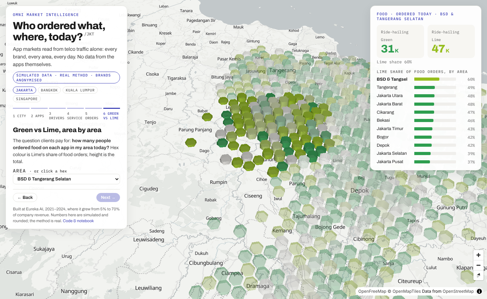

# Omni Market Intelligence

**Who ordered what, where, today?** App markets read from telco traffic: app users → drivers vs customers → service → orders, for every brand and every area at once.

[**▶ Live 3D map**](https://dhaneswaramandrasa.github.io/omni-market-intelligence/) · [Notebook](notebooks/omni_market_intelligence.ipynb) · [Portfolio](https://dhaneswara-mandrasa.vercel.app)



> **Simulated data, real method, anonymised brands.** I built the production version at Eureka AI (2021–2024)
> for super-app, ride-hailing and e-commerce clients in Jakarta, Bangkok, Kuala Lumpur and Singapore. It grew
> from 5% to 70% of company revenue. Clients, data and code stay confidential; this repo is a clean reimplementation.

## The question

*How many people in BSD ordered food on Ride-hailing Green today, compared with Ride-hailing Lime?*
Neither app shares its numbers. A mobile network sees every app's traffic, so it can estimate this for all of them.

| Brand (anonymised) | Kind | Services |
|---|---|---|
| Ride-hailing **Green**, Ride-hailing **Lime** | super-app | Ride · Car · Food · Mart |
| E-commerce **Orange**, E-commerce **Teal** | marketplace | Fashion · Electronics · Groceries · Home |

## The funnel

```
telco DAU (30M, Jabodetabek)
 └─ app users            host lookup on traffic                       Green ≈ 5.3M · Lime ≈ 4.1M
     ├─ drivers          classifier: partner endpoint, cells, hours    ≈ 7% of ride-hailing app users
     └─ customers
         ├─ service      classifier: host hint, bytes, duration, movement afterwards
         └─ ordered?     classifier: payment endpoint, heavier sessions, a trip right after
                                                                       ≈ 12% of sessions · ≈ 24% of customers
```

Models are gradient-boosted trees trained on a 10% labelled **panel** and scored on the rest:

| Step | Held-out result |
|---|---|
| Driver vs customer | precision 0.94 · recall 0.89 |
| Service | accuracy 0.89 (ride-hailing) · 0.86 (e-commerce) |
| Ordered? | AUC 0.96 · precision 0.78 · recall 0.80 |

The order threshold is set so the predicted rate matches the panel's rate, which keeps **area totals unbiased**
even though single sessions are uncertain. Clients buy the totals.


## The demo

`web/index.html` (MapLibre + deck.gl, no build step) reads `web/data/omni.json`, written by the notebook:

1. **The city breathes**: 2 km hexes, height = people on the network, over 24 hours
2. **Find the app users**: per brand, by hour
3. **Drivers vs customers**: animated driver trips for both ride-hailing brands
4. **Which service**: Ride / Car / Food / Mart, Fashion / Electronics / …
5. **Did they order**: users vs users who ordered, plus model quality
6. **Green vs Lime**: Lime's share of food orders per hex, for any area (BSD by default)


## Run it

```bash
pip install -r requirements.txt
cd notebooks && jupyter nbconvert --to notebook --execute --inplace omni_market_intelligence.ipynb
cd ../web && python -m http.server 8000   # open http://localhost:8000
```

## Layout

```
omni/        sim.py (hex grid, people, sessions, network features) · model.py (driver, service, order models; export)
notebooks/   omni_market_intelligence.ipynb, the full walk-through with outputs
web/         interactive 3D map + data/omni.json
docs/        figures
```

## In production

PySpark over clickstream and cell records · host-to-app dictionaries maintained per market · MLflow for model runs ·
daily refresh per city · outputs: market size, penetration and share by area, brand and service.

---
Dhaneswara Mandrasa · MIT License
